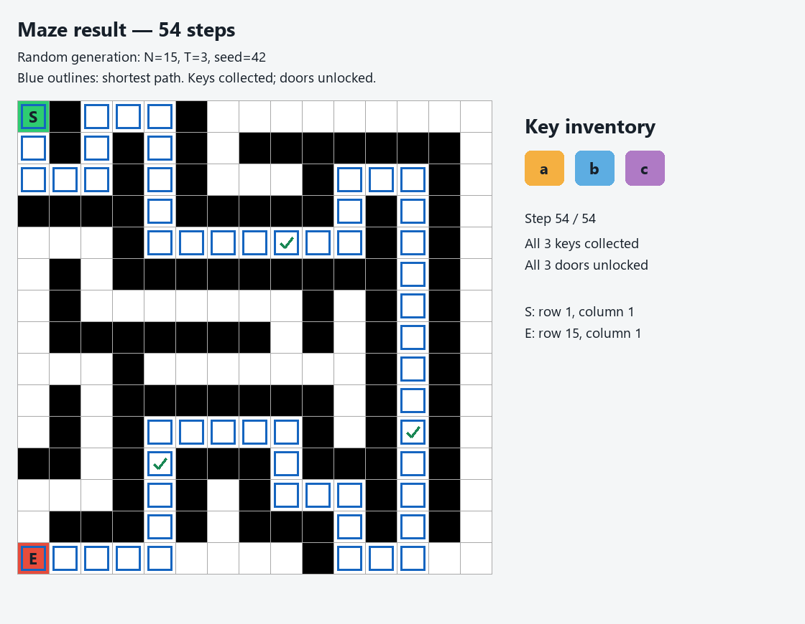

# DSAultRafale

## Problem 1: Maze with Keys and Doors

Used BFS over `(row, column, key mask)` to find the shortest valid path while tracking collected keys and checking locked doors. 
Added CSV input/output, solvable random mazes, and an animated grid showing the path, key inventory and door openings.

## Problem 2: Closest Pair of Points

Compared O(N²) brute force with O(N log N) divide-and-conquer to find the closest point pair and measure their execution times. 
Added point-distribution corner cases, recursion and strip-comparison animation, and a running-time-versus-N benchmark graph.

Input controls and corner-case selection

[Watch the Problem 2 demonstration](prob2/Screencast%20from%202026-10-14%2010-45-42.webm)

## Problem 3: Flight Route Planning with Coupons

Built a flight-route planner to find the lowest-cost journey within a maximum stop limit while choosing where to apply half-price coupons. 
Added manual and CSV flight input, random graph generation, a coloured route map, journey animation and marked CSV export.

CSV import

[Watch the Problem 3 demonstration](prob3/demo%20video.mp4)

## Problem 4: Exam Timetable Scheduling

Compared capacity-aware DSatur, Welsh–Powell and exact branch-and-bound to schedule conflicting exams in separate slots within the available hall capacity. 
Added a Streamlit dashboard with coloured conflict graphs, timetable assignments, optimality status, benchmarks, assignment replay and CSV/JSON exports.

Assignment replay, benchmark settings, methods and exported results

